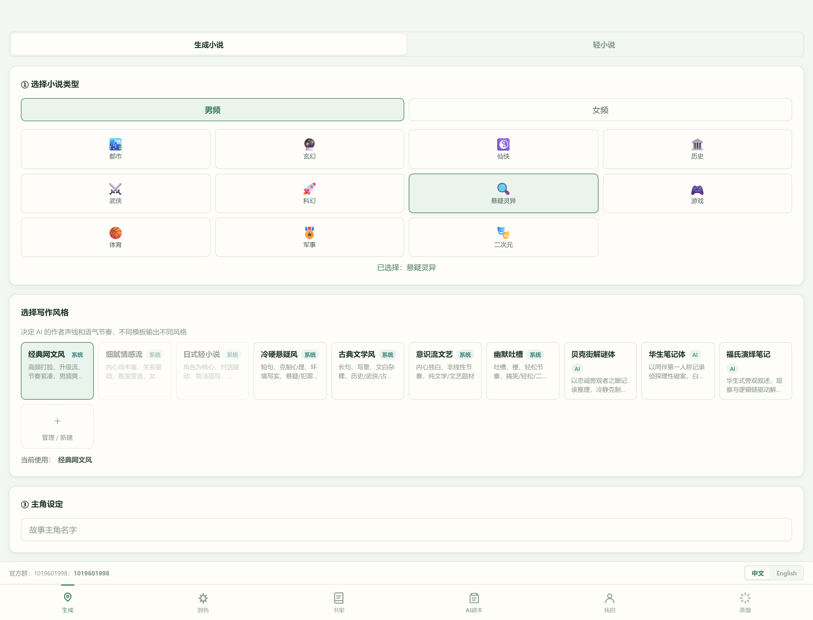
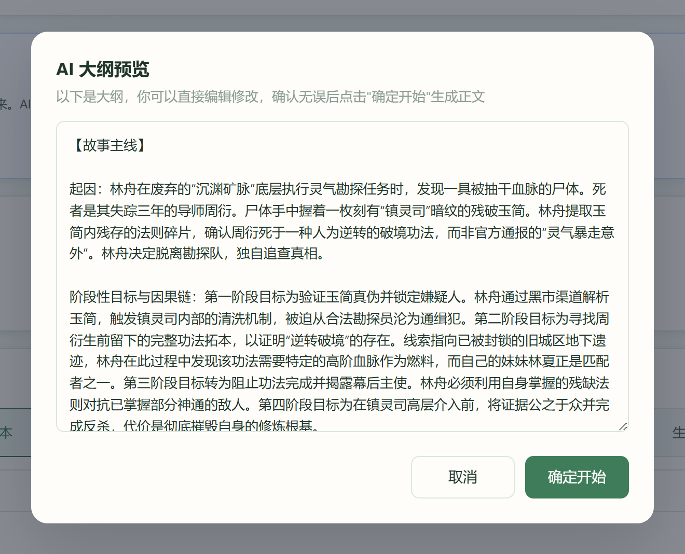
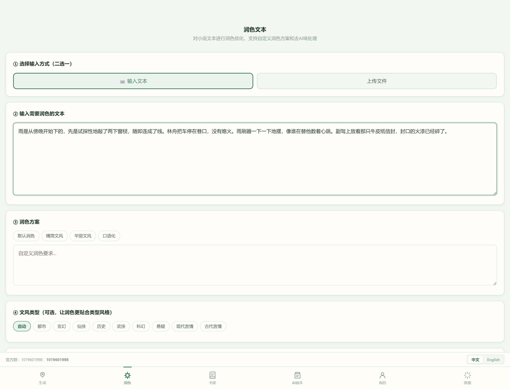
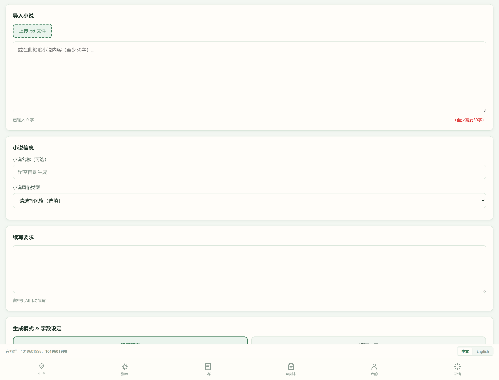

<div align="center">

# MirrorNovel

**面向长篇小说与连续短剧的 AI 创作工作台**

从题材、人设和世界观出发，完成大纲、故事蓝图、章节写作、参考分析、编辑润色与剧本改编。

[](LICENSE)
[](https://github.com/Aerdelan/MirrorNovel/releases/latest)
[](#community)

[下载与入门](#getting-started) · [功能详解](#features) · [自行部署](#self-hosting) · [许可说明](#license) · [免责声明](#disclaimer) · [加群交流](#community) · [English](#english)

</div>

> **使用前请先阅读[许可说明](#license)与[免责声明](#disclaimer)。** 本项目采用 **AGPL-3.0-only**；开源许可不等于免费模型服务，也不授予任何第三方作品的使用或改编权。
>
> **下载、配置或使用遇到问题？** 欢迎加入 QQ 交流群 **1019601998**。打开 QQ → 搜索 → 找群，输入群号申请加入；详细反馈方式见[交流与反馈](#community)。作者平时工作较忙，回复可能不及时。

## 项目介绍

MirrorNovel 将小说创作组织为可分步确认、持续编辑的工作流：先确定题材与风格，再规划大纲与蓝图，逐章生成、检查和修订，最后导出作品。已有正文可以导入续写，已有小说可以改编为连续短剧，也可以从原创设定创建剧本项目。

项目提供 Vue 网页用户端、Electron 桌面工作台、独立管理端及 uni-app 移动端工程。网页端与桌面端共用主要创作代码；移动端为独立实现，功能覆盖与发布节奏可能不同。本文按当前仓库实现说明，下载包、已部署服务器与源码之间可能存在版本差异。

<a id="getting-started"></a>

## 下载与入门

### Windows 桌面版

**[前往 GitHub Releases 下载最新版](https://github.com/Aerdelan/MirrorNovel/releases/latest)**，选择对应版本的 `MirrorNovel Setup x.y.z.exe` 安装。当前 Windows 构建面向 64 位系统，可选择安装目录并创建快捷方式。

- **桌面版需要连接后端。** 安装包包含桌面界面、本地静态服务和 API 代理，不包含 MongoDB、完整业务后端或模型权重；作品由连接的后端保存。
- **模型需要单独配置。** 登录后可在「模型线路」中填写接口地址、API Key 和模型名，再为大纲、正文、推理、润色分配线路。系统线路是否可用取决于后端配置。
- **当前 Windows 打包配置未启用代码签名。** 系统可能提示未知发布者；请确认安装包来自本仓库的 Release，并核对版本与来源后再决定是否安装。
- **切换到自建后端**可使用启动环境变量 `MN_API_TARGET`；开发模式使用 `MN_SERVER`。具体示例见[桌面端开发与打包](#desktop-development)。

开发构建可在 [Desktop Actions](https://github.com/Aerdelan/MirrorNovel/actions/workflows/build-desktop.yml) 中查看。CI 当前上传 Windows 安装包，不保证每次发布都提供便携压缩包；请以实际附件为准。

### 网页与移动端

| 入口 | 使用方式 | 注意事项 |
| --- | --- | --- |
| 网页用户端 | 访问部署者提供的站点，或按本文自行部署 | 登录同一后端的同一账号可访问对应作品 |
| Windows 桌面端 | 下载 Release 安装包 | 需要后端与可用模型线路，不是离线一体包 |
| Android APK | 打开 [Build Android APK](https://github.com/Aerdelan/MirrorNovel/actions/workflows/build-apk.yml)，在成功运行的 Artifacts 中查找 `fanqiexiaoshuo-app` | 当前流程构建 Debug APK；下载工件通常需要登录 GitHub，且受保留期限限制 |
| uni-app H5 / Android 工程 | 在 `app/` 中开发与构建 | API 地址和功能以移动端源码为准，详见 [app/README.md](app/README.md) |

### 第一次创作

1. 登录账号，在「我的」或桌面端「模型线路」中完成模型配置，并测试连接。
2. 打开「生成」，选择普通小说或轻小说，确定题材、标签、主角与世界观。
3. 生成或填写大纲，编辑后确认；整本创作继续生成并确认三级故事蓝图。
4. 按需选择写作风格、参考资料、专家团与联网取材，设置目标字数后开始生成。
5. 在书架或作品工作台查看章节、继续写作、编辑、润色和导出。需要停止整本生成时，点击「暂停」，等待状态确认。

<a id="license"></a>

## 许可说明：AGPL-3.0-only

**本项目采用 GNU Affero General Public License 第 3 版，SPDX 标识为 `AGPL-3.0-only`。** 仓库授权声明见 [LICENSE](LICENSE)，完整条款见 [GNU AGPL v3 原文](https://www.gnu.org/licenses/agpl-3.0.html)，也可查阅 [OSI 收录的协议全文](https://opensource.org/license/agpl-3-0)。以下是便于理解的摘要，不替代协议原文。

| 使用场景 | 许可边界与主要义务 |
| --- | --- |
| 使用、研究或修改软件 | 在遵守协议的前提下允许；运行原版软件不要求公开自己的小说、提示词或私人资料 |
| 商业使用或收费分发 | AGPL 允许，但仍须履行相应许可义务；收费不会免除源码提供义务 |
| 分发源码或安装包 | 保留适用的版权、许可与免责声明；修改版注明变更，受协议覆盖的作品继续按 AGPL 授权，并按协议提供对应源码、满足相应分发条件 |
| 运行修改版网络服务 | 按第 13 条，向通过网络与该版本交互的用户显著提供免费获取该版本对应源码的机会；对应源码不能仅指向未包含实际修改的上游仓库 |
| 第三方依赖、模型与参考内容 | 分别适用其自身许可、服务条款和权利限制，不能由本项目的 AGPL 授权替代 |

**请特别区分软件许可、在线服务规则与作品权利：**

- 本项目的 AGPL 授权允许符合条款的商业使用。历史页面若出现「仅限个人学习研究」或笼统「禁止商用」的表述，不应据此缩减本仓库许可证已授予的软件权利；在线服务的账号、配额与服务规则需另行说明。
- 使用本工具创作的小说、剧本或图片，不会仅因使用了本工具而自动适用 AGPL；具体权利仍取决于作品内容、输入素材、模型服务条款和适用法律。
- 软件许可不提供第三方小说、人物形象、插画、商标或其他素材的授权，也不保证模型输出具有独占性或可获得版权保护。

<a id="disclaimer"></a>

## 使用须知与免责声明

> **MirrorNovel 是 AI 创作辅助工具。生成、导入、改写、蒸馏或导出成功，只表示技术流程完成，不代表内容已经通过版权、事实或发布审核。**

### 内容与第三方作品

请仅上传和处理你拥有相应权利、获得授权，或依法可以使用的文本与素材。参考蒸馏用于分析叙事方法、语言特点与抽象结构；它不构成原作复制、传播、改编或商业使用的授权。风格档案可能包含原文选段，后续输出也可能出现近似表达，使用前仍需审查。

网页参考功能涉及第三方网站，目前仅向管理员开放。管理员需自行确认访问、下载、上传及后续处理的权利依据，并遵守站点条款和适用规则；请勿借此绕过付费、登录或其他访问限制。项目与相关小说平台之间不因该功能而形成授权、合作或背书关系。

AI 可能生成事实错误、逻辑矛盾、重复情节、近似已有作品的表达或不适宜内容。请在发表、投稿、商业使用或制作前进行人工审核，并遵守目标平台关于 AI 内容、标识和投稿的要求。「去 AI 味」仅指文字表达优化，不保证通过检测，也不构成规避披露义务的承诺。

### 数据、密钥与费用

- 作品、章节、参考文本及剧本保存在所连接后端的数据库中。使用他人部署的服务前，应了解其数据保存和访问规则；敏感、保密或尚未公开的素材请谨慎上传。
- 创作时会向选定模型服务发送任务所需的提示词、正文片段与上下文；启用联网取材、生图或网页参考时，还会访问对应第三方服务。
- 桌面端「仅存本机」表示模型配置保存在本机，调用时仍会随请求发送给后端，由后端访问模型；**不代表密钥从不离开设备，也不代表浏览器直接调用模型。**「同步到账号」则会将默认线路配置保存到服务端。
- 自带 API、搜索和生图服务可能收费；长篇写作、审稿、失败重试及批量修订都可能增加用量。界面中的 Token 统计不等同于最终账单，费用以实际服务商记录为准。
- 整本小说生成和整本续写可在页面断开后继续运行。关闭窗口或刷新页面不能作为停止计费的保证；请使用暂停操作并确认任务状态。不同工具的取消行为可能不同。

### 可用性与责任范围

本软件按现状提供。在适用法律允许的范围内，作者和贡献者不对创作质量、无错误运行、数据完整性、第三方服务可用性或特定用途作保证；责任限制以 AGPL 第 15、16 条及适用法律为准。本说明不排除依法不得排除的责任。

请定期导出重要作品并备份数据库。章节历史与断点保存用于辅助恢复，不能代替独立备份。自行部署者需负责其服务的访问控制、密钥保护、数据管理与对外服务规则；使用者应对自己的输入、操作和发布行为负责。

<a id="features"></a>

## 功能详解

### 1. 题材、人设与风格定调

- **普通小说与轻小说入口**：普通小说按男频 / 女频、分类、题材逐级选择，并组合情节元素、人设、基调与关系向；轻小说提供 ACGN 风格题材及角色设定。
- **主角与世界观**：填写角色信息、核心冲突和世界规则，让后续大纲与正文沿用同一组设定。
- **风格六轴**：题材和标签会影响叙述温度、语言密度、叙述者姿态、节奏、幽默与情绪表达，减少所有题材都套用相同文风的情况。
- **题材与标签约束**：类型信息进入大纲、章节计划和正文提示，用于约束题材表现、人物推进和基调，辅助减少长篇偏题；最终效果依赖模型执行能力。

类型体系及扩展方式见 [小说类型与多选标签说明](docs/NOVEL_TYPE_SKU.md)。

### 2. 大纲、三级故事蓝图与章节计划

整本创作先规划后执行。大纲支持 AI 流式生成、手动填写、编辑与确认；蓝图把宏观方向细化为后续写作依据：

| 层级 | 规划内容 | 作用 |
| --- | --- | --- |
| 全书级篇章 | 主线、阶段目标、主要阻力与关键反转 | 控制故事的大方向和阶段节奏 |
| 篇章内小阶段 | 人物声线、关系变化、标签兑现、必备场景与伏笔 | 将设定落实到具体阶段 |
| 滚动执行蓝图 | 未来约 10–20 章的执行卡、章节目的与章末钩子 | 为近期章节提供可执行安排 |

生成时结合章节计划、当前进度与上下文推进。作品详情支持蓝图复核、查看提案并决定是否应用；计划偏离复核可对近期正文与章节安排进行语义检查，供作者判断是否需要调整。

### 3. 整本生成、单章精写与导入续写

- **整本生成**：按目标字数和章节安排连续写作，实时查看阶段状态、正文与模型用量。
- **单章写作与章节续写**：需要细调时按章创作，也可在已有章节后继续追加内容。
- **整本续写**：根据已有作品的摘要、人物状态、计划和蓝图推进后续章节。
- **导入续写**：在「续写」页上传 `.txt` 或粘贴已有正文，填写续写方向和字数，整理上下文后继续创作。此入口与支持 EPUB / ZIP 的参考库导入是两套流程。
- **暂停与恢复**：生成任务记录状态与中章草稿；主动暂停后可从保存的进度继续。重启恢复依赖有效的任务记录与可用模型配置，不会保证所有任务自动重启。

整本生成和整本续写在客户端断线后可继续后台运行；返回作品页可重新查询进度。需要停止时应主动暂停，等待断点保存完成。服务端通过数据库租约、心跳与写入校验限制同一作品的重复生成任务。

### 4. 长篇连续性与专家团审稿

长篇上下文包含章节摘要、角色状态、伏笔、未决问题、阶段目标和情绪变化，用于辅助跨章衔接、设定保持与伏笔推进。

可选「专家团」在章节生成后参与连续性审阅，并在发现问题时进入修订流程。生成链路还包含章节计划、重复内容和质量检查等约束。这些机制用于降低跑题、重复和前后矛盾，仍需要作者检查关键情节与结局。

### 5. 写作人格与个人风格模板

「写作人格」用于控制作者声线、语气、节奏、词汇偏好及写作规则：

- 使用系统预设，或保持默认的「跟随题材与标签」自动定调。
- 手动创建个人模板、克隆系统模板为个人副本，或让 AI 辅助生成模板。
- 从已蒸馏的参考资料中提炼个人写作风格。
- 作品保存所选人格快照，后续修改模板不会直接改写已有作品的风格配置。
- 剧本支持专用人格，贯穿剧本圣经、分场生成和重生成。

### 6. 个人参考库、风格蒸馏与结构分析

在「参考上传与蒸馏」中上传文件或粘贴正文，按普通小说 / 轻小说及分类建立个人参考库。资料按账号隔离，可查看后台分析进度、失败原因、风格档案，并重新蒸馏或删除。

| 能力 | 具体说明 |
| --- | --- |
| 多格式导入 | 支持 `.txt`、`.md`、`.epub`、`.zip`；ZIP 可包含多卷 EPUB 或文本，EPUB 按阅读顺序提取正文 |
| 风格蒸馏 | 提取节奏、对话、描写、情感基调、写作特点、特色词汇和章节结构，形成可复用档案 |
| 结构分析 | 提炼阶段节奏、冲突与伏笔等抽象方法；分析结果可编辑，确认应用后才带入创作，也可取消 |
| 创作联动 | 最多选择三个已蒸馏参考，将确认后的参考与结构快照带入小说或剧本创作 |
| 可选文风示例 | 小说生成页可开启少量参考原文输入，默认关闭；每个参考最多一段240字符、合计最多三段，仅随正文生成与续写使用，不增加模型调用次数 |
| 人格提炼 | 将参考档案转为个人风格模板，便于后续复用 |
| 管理员网页参考 | 提供番茄书籍预览、TXT 下载、导入蒸馏和服务器 Cookie 管理；依赖第三方站点状态与合法访问条件 |

**导入规模与分析范围：**文本文件上限 10 MB，EPUB / ZIP 上限 50 MB，解析展开预算 100 MB；每包最多二十本、最多一万条目录项。参考库文本预算最多五百万字符，超出预算会抽样保留。长文蒸馏最多均匀分析二十段、每段约两万字符，覆盖开头、中段与结尾，随后合并报告；**不代表逐字分析全部原文**。结构分析和即时人格提炼还使用各自的较短样本预算。

解析器不执行导入文件中的 HTML 脚本，不向磁盘解压用户文件。当前不支持 RAR / 7z。格式支持不改变素材的版权与授权要求。

### 7. 润色、去 AI 味与编辑引擎

| 工具 | 适用场景 | 提供的操作 |
| --- | --- | --- |
| 文本润色 | 调整句式、表达与叙事流畅度 | 流式查看结果，按需保存或导出 |
| 去 AI 味 | 减少套话、机械连接和重复修辞 | 两遍改写、差异对比，并按需回写章节；作品页可逐章处理整本 |
| 编辑引擎 | 需要系统修订结构和文风 | 结构重构 → 风格一致 → 去 AI 化的三阶段流程，支持章节与整本处理 |
| 全文调优 | 排查长篇重复、节奏与伏笔问题 | 后台分析并逐章优化，可查询进度和结果 |
| 关键字提取 | 回看章节内容要点 | 按章提取关键字，辅助整理 |

改写可能改变细节、语气或人物表达，回写前请检查差异。去 AI 味功能不提供「检测通过率」承诺。

### 8. 书架、章节编辑、历史恢复与导出

- 在书架中集中管理作品、查看创作状态、进入详情、续写或删除。
- 按章阅读、编辑、删除或续写，支持修改作品大纲。
- 章节编辑会按账号、作品与章节暂存本机草稿；关闭或离开前提示未保存修改，重新打开可恢复。草稿与当前正文冲突时需手动选择，本机暂存失败时也会提示。
- 小说支持 TXT 导出及 ZIP 批量导出，便于保存整本和分章节文本。
- 手工编辑、续写追加、润色、编辑引擎与全文调优等修改正文前保存章节历史；每章最多保留最近八个历史版本。
- 恢复历史版本时重建摘要、字数和续写上下文；生成期间禁止回退，避免覆盖正在写入的章节。

历史记录从启用该功能后的修改开始积累，并非无限版本库。

### 9. 连续短剧与小说改编工作台

「AI 剧本」提供独立项目工作流，支持原创短剧和当前账号已有小说的改编：

1. **确定来源与交付目标**：选择原创 / 小说改编，以及「视频生成」或「实拍制作」；设置集数、单集时长、核心设定或改编重点。
2. **扩展创意**：原创项目可让 AI 补充人物、空间、支线和伏笔；可选择是否同时规划主线，再确认应用。
3. **建立剧本圣经**：统一故事前提、角色视觉与目标、人物关系、场景空间和连续性规则，并规划分集大纲。
4. **逐集逐场创作**：视频生成方向侧重镜头、画面重点与转场；实拍方向侧重布景、走位、道具与执行提示。
5. **质量检查与修复**：支持单集生成、重生成、批量生成未完成集、一键修复问题剧集，以及暂停和继续批量任务。
6. **导出交付**：支持 TXT、Markdown、HTML、DOCX；桌面端可使用保存对话框。

已有剧本可逐场手工编辑动作、对白、潜台词和制作说明，保存不会调用 AI。场景编辑同样提供本机草稿保护，并检查生成占用及原文版本，避免覆盖正在生成或已经更新的内容；已有配图不会随文字修改自动重生成。

小说改编会携带来源快照，并沿用相关参考与人格信息。**「视频生成」是剧本文本的交付方向，当前工作台不负责调用视频模型生成完整视频。**

### 10. 剧本配套生图

管理员配置生图线路后，可在剧本项目中按需启用人物头像、关系图、场景 / 转场站位图，查看图片并重试失败资产。系统按内容与交付方式组织尺寸和数量，生图请求串行执行。

生图为可选功能，未启用时不会调用生图模型；没有配置可用生图线路仍可使用文字剧本。管理端提供两条生图线路配置，图片服务的费用、输出限制和素材使用权由对应服务及输入内容决定。

### 11. 模型线路、思考过程与 Token 用量

文本生成支持 OpenAI Chat Completions 兼容接口，以及后端可访问的 Ollama 服务；不同服务商的参数、上下文和流式格式存在差异，需要实际验证。

当前按四类任务分配线路或模型：

| 任务角色 | 用途 |
| --- | --- |
| `outline` 大纲 | 创作大纲、剧本规划等 |
| `writing` 正文 | 小说章节与剧本正文 |
| `reasoning` 推理 | 规划、审阅、参考蒸馏与结构分析等 |
| `polish` 润色 | 表达修改与编辑相关处理 |

- **系统线路**由管理员维护；网页个人中心可选择默认与任务线路，也可配置自带接口。
- **桌面多线路**最多管理六条本机线路，分别设置接口、密钥及各任务模型；任务可跟随默认线路或单独指定，也可将默认线路同步到账号。
- **思考模型适配**按任务设置思考策略与预算，对过长思考、无正文和部分输出截断进行保护或重试；是否能显示思考内容取决于提供方返回格式，不保证所有模型一致。
- **实时用量**展示输入、输出、推理与缓存等可获得的统计信息；部分用量来自估算，失败或重试调用也可能产生费用。

### 12. 联网取材、多端体验与管理后台

- **联网取材**：创作时可启用检索或填写资料链接。自动检索可配置 Tavily、Serper、Brave；默认 `WEB_SEARCH_PROVIDER=none` 关闭自动检索，但用户提供的链接仍可触发抓取。资料会被裁剪后注入上下文，不保证真实性或完整性。
- **桌面工作台**：采用章节栏、正文区与上下文检查器的三栏布局，支持侧栏收起、布局偏好与窗口尺寸记忆，减少长篇编辑时的页面切换。
- **语言**：提供中文与英文界面及切换入口；部分新增剧本界面仍有中文固定文案。
- **管理端**：提供数据概览、用户管理、小说 Token 用量报表、文本模型线路、剧本输出预算与生图线路配置。
- **账号**：提供邮箱验证码注册、登录、找回密码、个人资料与邀请信息等入口。

## 界面预览

以下为已有界面截图，具体布局以当前版本为准。

<div align="center">
  
  
</div>

| 文本润色 | 导入续写 |
| --- | --- |
|  |  |

<a id="self-hosting"></a>

## 自行部署与本地开发

### 环境与项目结构

- **Node.js 22**：当前质量检查与桌面构建使用此版本；服务端部分依赖要求至少 20.19.0，Windows 测试命令也依赖较新 Node 的文件匹配能力，建议直接统一为 22。
- **MongoDB**：建议 6 或更高版本，服务账号需要创建集合和索引的权限。
- **可用文本模型**：兼容 Chat Completions 的 API，或后端可访问的 Ollama。
- **SMTP**：正常邮箱注册和找回密码需要可用的邮件服务。
- **可选依赖**：自动检索服务、生图服务；网页参考相关浏览器能力需要 Playwright Chromium。普通小说写作不需要生图或网页参考配置。

```text
MirrorNovel/
├── server/        # Express API、MongoDB 模型、生成任务、参考库与剧本服务
├── client/        # Vue 3 网页用户端，桌面端复用其主要创作代码
├── desktop/       # Electron 外壳、三栏工作台、本地静态服务与 API 代理
├── admin/         # Vue 3 管理后台
├── app/           # uni-app H5 / Capacitor Android 工程
├── shared/        # 跨端公共逻辑
├── docs/          # 类型体系、迁移记录、测试记录与截图
├── .github/       # 质量检查、Windows 与 Android 构建流程
├── PROJECT_ARCHITECTURE.md
└── LICENSE
```

网页、桌面和移动端通过 API 访问 Express 服务；服务端读写 MongoDB，并调用文本模型、SMTP 及可选的搜索 / 生图服务。桌面端的本地 HTTP 服务只负责界面与 API 转发，不替代业务后端。

### 安装与启动

在仓库根目录执行：

```bash
git clone https://github.com/Aerdelan/MirrorNovel.git
cd MirrorNovel
npm --prefix server ci
npm --prefix client ci
npm --prefix admin ci
```

将 `server/.env.example` 复制为 `server/.env`：

```powershell
# Windows PowerShell
Copy-Item server/.env.example server/.env
```

```bash
# macOS / Linux
cp server/.env.example server/.env
```

填写数据库、随机密钥、管理员账号、模型与 SMTP 配置。**示例文件中的默认管理员密码和 JWT 密钥必须替换。** 启动前先确保 MongoDB 可连接。

分别打开三个终端，在仓库根目录运行：

```bash
# 终端 1：API
npm --prefix server run dev
```

```bash
# 终端 2：用户网页
npm --prefix client run dev
```

```bash
# 终端 3：管理网页
npm --prefix admin run dev
```

| 服务 | 默认开发地址 |
| --- | --- |
| API 健康检查 | `http://localhost:3000/api/health` |
| 用户网页 | `http://localhost:5173` |
| 管理网页 | `http://localhost:5174` |

用户端与管理端通过 Vite 代理将 `/api` 转发至 `localhost:3000`。首次启动时，服务端在指定邮箱不存在的情况下创建管理员；后续修改 `.env` 中的密码不会自动重置已有账号密码。

### 服务端配置

下面是配置示例，所有 `replace_...` 均需替换为自己的值；不要将真实凭据提交到仓库。

```env
MONGODB_URI=mongodb://127.0.0.1:27017/mirrornovel
PORT=3000
NODE_ENV=development

JWT_SECRET=replace_with_a_long_random_secret
JWT_EXPIRES_IN=7d
MODEL_KEY_SECRET=replace_with_another_long_random_secret

ADMIN_EMAIL=admin@example.com
ADMIN_PASSWORD=replace_with_a_strong_password
ADMIN_NICKNAME=管理员

AI_API_BASE=https://api.example.com/v1
AI_API_KEY=replace_with_your_api_key
AI_MODEL=replace_with_your_model_name

EMAIL_HOST=smtp.example.com
EMAIL_PORT=465
EMAIL_USERNAME=noreply@example.com
EMAIL_PASSWORD=replace_with_your_smtp_password
EMAIL_SECURE=true
```

| 配置 | 说明 |
| --- | --- |
| `MODEL_KEY_SECRET` | 加密存入账号等敏感配置的密钥，未设置时回退使用 `JWT_SECRET`；应独立设置、备份并妥善保管，直接替换可能导致旧密钥无法解密 |
| `CORS_ORIGIN` | 允许跨域的前端来源，多个地址用英文逗号分隔；默认包含本地 5173 / 5174 |
| `MODEL_NORMAL_1_BASE_URL` / `_API_KEY` / `_MODEL` | 单独覆盖 `normal_1` 线路；其他预置线路为 `normal_2`、`advanced_1`、`vip`、`svip`，使用相应大写前缀 |
| `AI_THINKING_MODE` | `auto` / `enabled` / `disabled`，默认按任务采用策略 |
| `AI_THINKING_BUDGET` / `AI_THINKING_MAX_CHARS` | 思考预算与保护阈值；可用 `AI_THINKING_BUDGET_WRITING` 等按任务覆盖 |
| `WEB_SEARCH_PROVIDER` | `none` / `tavily` / `serper` / `brave`；配合对应 API Key 启用自动检索 |
| `TAVILY_API_KEY` / `SERPER_API_KEY` / `BRAVE_API_KEY` | 对应检索服务的凭据，不需要全部配置 |
| `EMAIL_RETURN_CODE_ON_FAILURE` | 仅本地排障使用；必须同时设置 `NODE_ENV=development` 与此项为 `true`，发信失败时才返回并记录明文验证码，生产环境不要启用 |

未配置 SMTP 时，普通注册和密码重置邮件不能正常发送，不会默认在生产日志中提供明文验证码。健康检查可查看邮件服务状态。搜索规模、抓取预算等更多示例见 [server/.env.example](server/.env.example)；生图线路与剧本预算在管理端配置。

### Ollama 与自带接口

Ollama 常见地址为 `http://127.0.0.1:11434`。**模型调用由后端发起，后端配置中的 `localhost` 指后端所在机器。** 如果后端部署在远程服务器，它不能直接访问你电脑上的 `localhost`；需要配置实际可达且受保护的网络地址。

使用云端接口时，填写兼容服务的 Base URL、API Key 和实际模型名。在个人中心或桌面模型页测试连接后，再进行长篇生成；短请求测试通过不代表长篇上下文、思考参数和生图协议都兼容。

<a id="desktop-development"></a>

### 桌面端开发与打包

桌面工程复用 `client/src`，应保留完整仓库结构，并先安装用户端依赖。

```bash
npm --prefix desktop ci
npm --prefix desktop run build
npm --prefix desktop run dist
```

Windows 安装包输出到 `desktop/release/`。当前 CI 在 Windows 上构建 NSIS 安装包；不要仅凭配置中存在 macOS / Linux 目标就假定仓库已提供对应安装包。

本地连接自建后端，使用两个 PowerShell 终端，在仓库根目录执行：

```powershell
# 终端 1：桌面渲染层（API 后端应先启动）
$env:MN_SERVER = 'http://127.0.0.1:3000'
npm --prefix desktop run dev
```

```powershell
# 终端 2：Electron 窗口
npm --prefix desktop run electron:dev
```

桌面 Vite 默认使用 5174，与管理端开发端口相同，二者同时开发时需调整其一的端口及相应开发地址。打包后启动程序可通过 `MN_API_TARGET` 覆盖 API 代理目标，例如在安装目录执行：

```powershell
$env:MN_API_TARGET = 'http://127.0.0.1:3000'
.\MirrorNovel.exe
```

运行中的 Electron 进程不会因另一个终端设置环境变量而自动更改后端，应退出后从设置了变量的终端重新启动。`MN_API_TARGET` 是运行时设置；仅在打包前设置它不会自动固化进安装包。

### 测试与构建

以下命令在仓库根目录执行；测试数量以当前运行结果为准。

```bash
npm --prefix server test
npm --prefix client test
npm --prefix client run check:i18n
npm --prefix client run build
npm --prefix admin run build
npm --prefix desktop run build
```

创作功能集成测试需要本机 MongoDB，使用独立临时测试库；运行前确认测试连接与数据隔离：

```bash
npm --prefix server run test:creative-integration
```

移动端单独安装和构建：

```bash
npm --prefix app install --legacy-peer-deps
npm --prefix app run build:h5
```

Android 构建还需要 Java、Android SDK 与 Capacitor 环境，可参考 [APK 构建工作流](.github/workflows/build-apk.yml)。普通前端构建不需要调用付费模型；真实模型、第三方网页和生图服务的兼容性应在自己的环境单独验证。

### 生产部署

- 设置 `NODE_ENV=production`，使用自己的随机 JWT / 加密密钥与管理员凭据；不要直接使用示例账号。
- 构建 `client` 和 `admin`，通过 Nginx / Caddy 等托管静态文件，配置 SPA 路由回退，将 `/api` 反代至 Express；进程可由 PM2 / systemd 等守护。
- 为 SSE 配置合适的长连接超时并关闭代理缓冲；不要让常规短请求超时中断长篇生成。
- 启用 HTTPS，限制 MongoDB 网络访问，配置允许的前端来源；不要把 API Key、Cookie、验证码或请求级模型配置写入代理访问日志。
- 项目已提供密码哈希、JWT 鉴权、账号权限校验、邮箱验证码限制与安全响应头；对公网部署仍需按实际规模配置网关保护、日志管理与备份。
- 账号模型密钥及生图密钥使用加密保存，公开配置接口只返回配置状态或尾部提示；这不能替代 HTTPS、服务器权限管理与数据库保护。
- 更新前暂停任务并备份代码、数据库及加密密钥，保持桌面 / 网页与服务端版本匹配。服务重启后，按任务状态手动继续需要恢复的创作。

## 开发文档与接口入口

| 文档 | 内容 |
| --- | --- |
| [PROJECT_ARCHITECTURE.md](PROJECT_ARCHITECTURE.md) | 架构与基础接口说明；新增接口及行为以当前路由代码为准 |
| [小说类型与标签体系](docs/NOVEL_TYPE_SKU.md) | 频道、题材、标签、风格六轴与题材约束 |
| [创作功能迁移记录](docs/creative-feature-migration-20261014.md) | 参考库、剧本、生图、章节历史与任务机制的实现边界 |
| [写作风格与修订能力规划书](docs/WRITING_STYLE_ROADMAP.md) | 本次初步实现、后续分阶段任务、兼容要求、验收标准，以及可交给其他 AI 的执行提示 |
| [邮箱验证码修复记录](docs/email-code-fix-20261022.md) | 邮箱投递、健康检查与故障恢复 |
| [RELEASE_NOTES.md](RELEASE_NOTES.md) | 历史用户更新记录，具体版本功能请结合源码与发布说明确认 |

| API 前缀 | 职责 |
| --- | --- |
| `/api/auth` | 注册登录、验证码、密码重置、个人资料与模型配置 |
| `/api/novel` | 题材、大纲、蓝图、生成续写、书架、章节、编辑、任务状态与历史恢复 |
| `/api/persona` | 写作人格管理、克隆、AI 生成与参考提炼 |
| `/api/reference` | 个人参考库、结构分析、蒸馏和受限的管理员网页参考功能 |
| `/api/screenplay` | 剧本项目、圣经、分集、批量任务、生图资产与导出 |
| `/api/admin` | 管理概览、用户、用量、文本模型、剧本与生图配置 |
| `/api/health` | API 与邮件服务健康状态 |

## 已知限制

- 长篇质量和响应速度受模型能力、上下文长度、线路负载与服务稳定性影响；目标字数、剧情约束和自动修订都不构成成稿质量保证。
- 参考分析采用受预算约束的抽样，可能遗漏原作细节；导入成功不代表已完整理解整部作品。
- 第三方网页、搜索、生图与 SMTP 可能失效或限流，相关能力需要独立配置和维护。
- 桌面端需要后端；「本机线路」不等同于完全离线。移动端也不保证与网页 / 桌面端逐项一致。
- 小说用量报表与剧本任务的统计范围不同，不能将某一张报表视为全部外部服务账单。

<a id="community"></a>

## 加群交流与问题反馈

**QQ 交流群：`1019601998`**

需要安装帮助、模型配置排查、创作交流或功能建议，可按以下步骤加入：

1. 打开手机或电脑 QQ，进入「搜索 / 找群」。
2. 输入群号 **1019601998**，核对群号后申请加入。
3. 进群后说明使用的客户端版本、后端环境和问题。作者平时工作较忙，请给回复留出时间。

仓库当前提供的是群号入口，请通过 QQ 搜索加群。加群不是使用开源软件的前置条件，也不代表附带免费额度、充值承诺或即时技术支持。

需要可追踪的缺陷反馈，请提交 [GitHub Issue](https://github.com/Aerdelan/MirrorNovel/issues)，建议附上版本、复现步骤、预期与实际结果，以及脱敏后的截图或错误信息。**请勿在群聊、Issue 或截图中公开 API Key、Cookie、验证码、密码和未授权的完整作品。**

欢迎提交文档修正、问题修复和功能改进 PR。涉及复现材料时，请优先使用自己的测试文本，并说明验证方式。

<a id="english"></a>

## English overview

MirrorNovel is an AI writing workspace for long-form fiction and episodic screenplays. It combines genre and character settings, editable outlines, three-level story blueprints, chapter generation, continuity review, writing personas, reference analysis, revision tools and exports.

- **Fiction:** whole-book and single-chapter writing, TXT import and continuation, persistent generation progress, chapter editing and up to eight saved historical versions per chapter.
- **References:** personal TXT / Markdown / EPUB / ZIP library, sampled style analysis, editable structure analysis and persona extraction. Long texts are sampled within processing budgets rather than read in full by the model.
- **Screenplays:** original concepts or adaptation of the account's novels, a screenplay bible, episode outlines, scene writing, batch generation and repair, optional images, and TXT / Markdown / HTML / DOCX exports. The “video generation” target produces screenplay and shot guidance, not finished videos.
- **Models:** OpenAI Chat Completions compatible services and backend-accessible Ollama, with `outline`, `writing`, `reasoning` and `polish` roles. The desktop client supports local multi-route configuration.
- **Clients:** Vue web client, Electron desktop workspace, admin console and a separate uni-app mobile project. Feature coverage varies by client and version.

**[Download for Windows](https://github.com/Aerdelan/MirrorNovel/releases/latest)** or follow the [self-hosting instructions](#self-hosting). The current CI uses Node.js 22. MongoDB, a reachable model service and SMTP for email flows are needed for a self-hosted setup. The desktop installer does not bundle a backend or model weights.

**License:** [AGPL-3.0-only](LICENSE). Commercial use is permitted subject to the license. Distribution and modified network services have source-availability obligations; see the [license section](#license) and full license text linked there. Using this tool does not itself place your fiction under AGPL or grant rights to third-party material.

**Before use:** review the [disclaimer](#disclaimer). Content requires human review; API services may charge for calls and retries. “Local configuration” is sent to the backend when needed for model calls. Whole-book generation and continuation can keep running after disconnection; explicitly pause the task and check its status to stop it. Keep independent backups.

**Community:** QQ group **1019601998** — search for this group number in QQ, or report reproducible bugs through [GitHub Issues](https://github.com/Aerdelan/MirrorNovel/issues). Never share credentials or private manuscripts in public reports.
